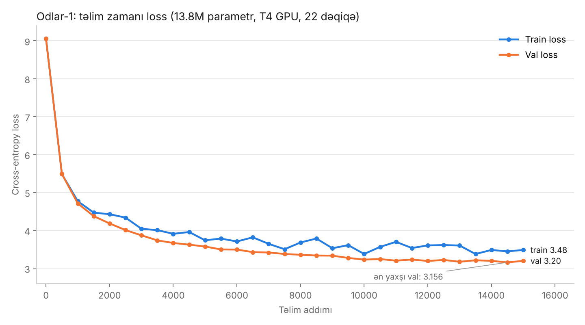

# Odlar-1: təlim nəticələri

**Təlim:** Google Colab, T4 GPU, 25 noyabr 2026
**Model:** 13.8M parametr (6 qat, 6 baş, 384 ölçü, kontekst 256 token)
**Data:** Azərbaycan Vikipediyası (`wikimedia/wikipedia`, `20231101.az`, 230 MB parquet). Dump-da 196,158 məqalə var; 200 simvoldan qısa olanlar atıldı və 134,447 məqalə qaldı: 300M simvol, 84.6M token
**Tokenizer:** Byte-level BPE, 8000 token

**Nəticə:** ən yaxşı val loss **3.156** (addım 14,500), perplexity ≈ 23. Təlim 15,000 addım, 22 dəqiqə çəkdi.

- Addım-addım loss və nümunələr (31 nöqtə): [`odlar1_training_log.csv`](odlar1_training_log.csv)
- Colab-ın tam, xam logu: [`odlar1_training_log_full.txt`](odlar1_training_log_full.txt)
- Son modelin nümunələri və təhlili: [`odlar1_final_samples.md`](odlar1_final_samples.md)
- "Paytaxt" testi (ehtimallar, Bakı vs Ankara): [`odlar1_paytaxt_testi.md`](odlar1_paytaxt_testi.md)

## Müşahidələr
- **Addım 0:** təsadüfi söz yığını (val loss 9.05)
- **Addım 500:** sözlər bir-birinə bağlanmağa başlayır (5.49)
- **Addım 1000:** qrammatika ortaya çıxır, şəkilçilər düzgün işlənir (4.71)
- **Addım 1500–3500:** Vikipediya üslubu: tarixlər, təşkilat adları, kateqoriyalar (4.38 → 3.74)
- 500 addım ≈ 0.7 dəqiqə; təlimin tamamı 22.2 dəqiqə

## Ekran şəkilləri
- [Data yükləmə və tokenizer](screenshots/01_data_and_tokenizer.png): tokenizer "Bakı", " Azərbaycanın", " paytaxtı" sözlərini bütöv tanıyır, "dır" şəkilçisini ayırır (ekranda byte-level formada görünür: `Ġ` = boşluq, `ı` = ı)
- [Təlim: addım 0–1500](screenshots/02_training_steps_0-1500.png)
- [Təlim: addım 0–3500](screenshots/03_training_steps_0-3500.png)
- [Təlim: addım 10500–14500](screenshots/04_training_steps_10500-14500.png)
- [Lokal sayt (Gradio)](screenshots/05_local_site.png)
- **Addım 5000:** ilk dəfə rəsmi-sənədli üslubdan kənar, sərbəst cümlə: *"bu günə qədərki bir çox şöhrət və ya siyasi xarakter ilə yanaşı, həm də elmi-tədqiqat işləri davam etdirirdi"*
- **Addım 9000:** tərcümeyi-hal formatı tam mənimsənilib: *"1956-cı il avqustun 11-də Bakı şəhərində anadan olmuşdur. İbtidai təhsilini burada almış..."*
- **Addım 10500–15000:** val loss 3.16–3.24 arasında sabitləşir; model öz tutumunun həddinə çatır. Kiçik modellərə xas təkrarlar görünür ("milli milli futbol").
