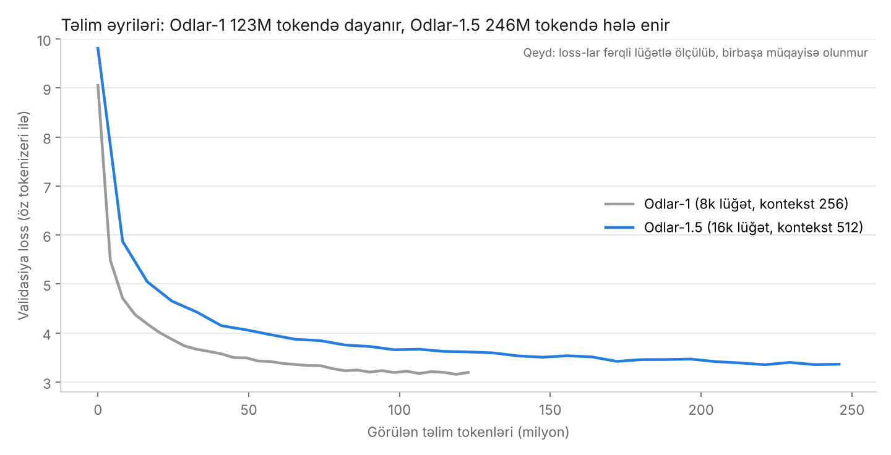
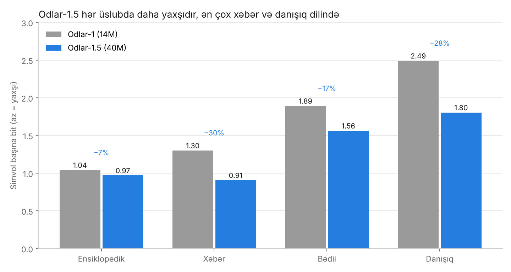
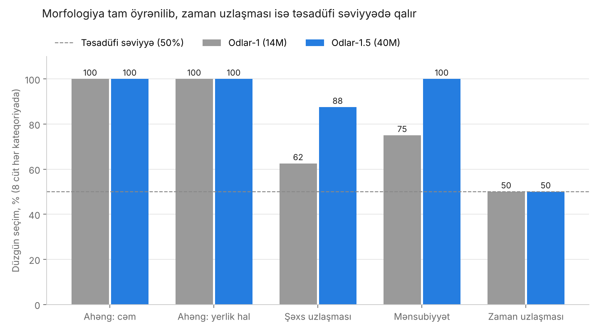

# Məqalə üçün nəticələr: Odlar-1 və Odlar-1.5

Bütün təcrübələr təkrarlana bilər: skriptlər və test dəstləri [`../eval/`](../eval/) qovluğundadır.
Test mətnləri heç bir modelin təlim datasında olmayan, bu iş üçün xüsusi yazılmış mətnlərdir.

## 1. Modellər
| | Odlar-1 | Odlar-1.5 |
|---|---|---|
| Parametr | 13.8M | 40.0M |
| Qat / ölçü / attention başı | 6 / 384 / 6 | 10 / 512 / 8 |
| Kontekst | 256 | 512 |
| Tokenizer | byte-level BPE, 8k | byte-level BPE, 16k |
| Data | Az. Vikipediya, 84.6M token | Az. Vikipediya + FineWeb-2 (azj_Latn), 345M token |
| Təlim | 15k addım × 8,192 token, 22 dəq, 1×T4 | 15k addım × 16,384 token, 118 dəq, 1×T4 |
| Brauzer modeli (ONNX int8) | 17 MB | 49 MB |

## 2. Dil modelləşdirmə: simvol başına bit (BPC)
16 görünməmiş mətn, 4 üslub ([`eval_texts.json`](../eval/eval_texts.json), [`bpc.py`](../eval/bpc.py)). Az = yaxşı.

| | Odlar-1 | Odlar-1.5 |
|---|---|---|
| BPC, cəmi (fp32) | 1.543 | **1.224** (−20.7%) |
| BPC, cəmi (int8 ONNX) | 1.542 | 1.224 |

int8 kvantlaşdırma model ölçüsünü ~3.3 dəfə kiçildir və BPC-ni 0.004-dən az dəyişir.

## 3. Qrammatika: minimal cütlər (40 cüt, 5 kateqoriya)
Model düzgün cümləyə səhv cümlədən yüksək ehtimal verirmi? ([`minimal_pairs.json`](../eval/minimal_pairs.json))

| Kateqoriya | Odlar-1 | Odlar-1.5 |
|---|---|---|
| Saitlərin ahəngi: cəm | 8/8 | 8/8 |
| Saitlərin ahəngi: yerlik hal | 8/8 | 8/8 |
| Şəxs uzlaşması | 5/8 | 7/8 |
| Mənsubiyyət şəkilçisi | 6/8 | 8/8 |
| Zaman uzlaşması (zərf–feil) | 4/8 | 4/8 |
| **Cəmi** | **31/40** | **35/40** |

Müşahidə: lokal morfologiya (ahəng, şəkilçi) hər iki ölçüdə tam öyrənilib. Cümlə boyunca semantik uzlaşma ("dünən" → keçmiş zaman) təsadüfi səviyyədədir. Hər iki modelin səhvlərinin əksəriyyəti gələcək zamanlı düzgün cümlələrdədir: modellər keçmiş zamana meyillidir (çox güman ki, xəbər və ensiklopedik mətnlərin keçmiş zamanda yazılması səbəbindən).

## 4. Fakt bilgisi: paytaxt testi (20 ölkə)
| | Odlar-1 | Odlar-1.5 |
|---|---|---|
| Düzgün cavab 1-ci yerdə | 2/20 | 7/20 |
| Düzgün cavab ilk 10-da | 6/20 | 13/20 |

Ətraflı: [`odlar1_vs_odlar15.md`](odlar1_vs_odlar15.md).

## 5. Nümunədən öyrənmə (in-context learning)
"Ölkə - paytaxt" formatında 10 ölkə: nümunəsiz və 3 nümunə ilə. Hər iki model hər iki şəraitdə **0/10**. Bu ölçüdə nümunədən öyrənmə bacarığı yaranmayıb. Sadə toplama ("2 + 2 =") da hər iki modeldə uğursuzdur.

## 6. Tokenizer və generasiya
| | Odlar-1 | Odlar-1.5 |
|---|---|---|
| Söz başına token (fertility) | 1.77 | 1.49 |
| Token başına simvol | 3.75 | 4.40 |
| distinct-2, təkrar cəzası yoxdur | 0.878 | 0.756 |
| distinct-2, təkrar cəzası 1.3 | 0.993 | 0.992 |
| CPU sürəti (1 thread, fp32) | 51 token/s | 17 token/s |
| Brauzer (WASM, int8, 1 thread) | ~19 token/s (istifadəçi noutbuku) | ~8–10 token/s (headless Chromium) |

Müşahidə: veb datası ilə öyrədilmiş Odlar-1.5 təkrar cəzası olmadan daha çox təkrarlayır (xəbər şablonları). Sadə təkrar cəzası (1.3) bunu hər iki modeldə praktik olaraq aradan qaldırır.

## Əsas nəticələr
1. Pulsuz bir T4 GPU ilə 2 saatdan az vaxtda Azərbaycan dilinin morfologiyasını tam mənimsəyən model öyrətmək mümkündür.
2. Modeli 3 dəfə böyütmək və datanı 4 dəfə artırmaq BPC-ni 21% yaxşılaşdırır, qazanc ən çox ensiklopediyadan kənar üslublardadır (xəbər −30%, danışıq −28%).
3. Fakt bilgisi tezliyə bağlıdır və datanın tərkibini əks etdirir: veb datası qonşu ölkələr haqqında bilgini gücləndirir, bəzilərini zəiflədir.
4. Semantik uzlaşma, riyaziyyat və nümunədən öyrənmə 40M ölçüsündə yaranmır.
5. int8 kvantlaşdırma ilə belə modellər keyfiyyət itirmədən tamamilə brauzerdə işləyə bilir.
