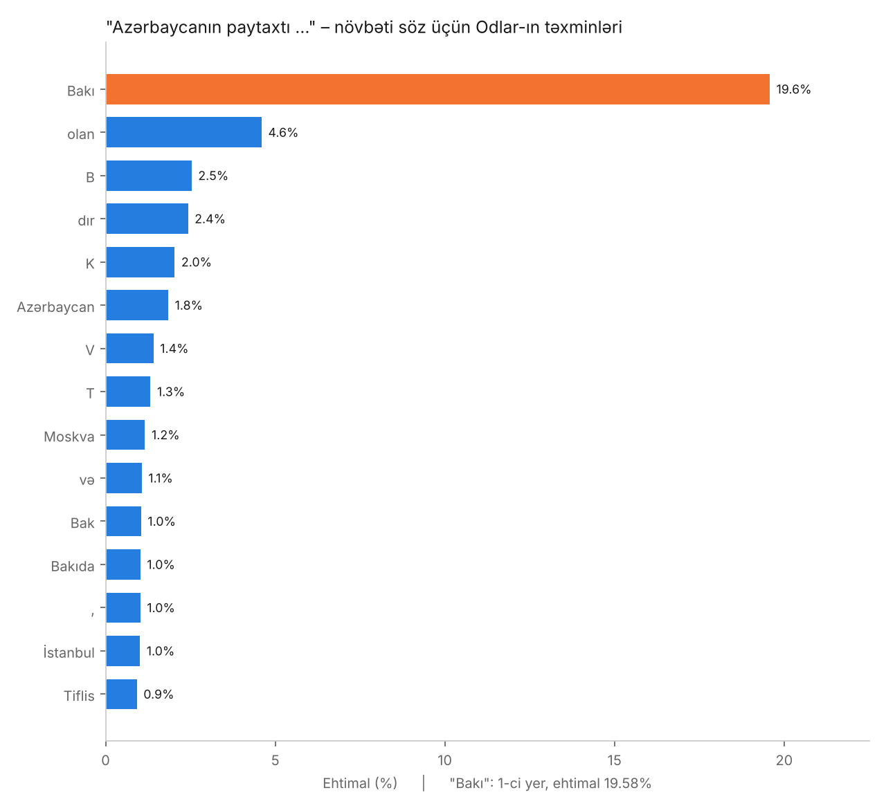
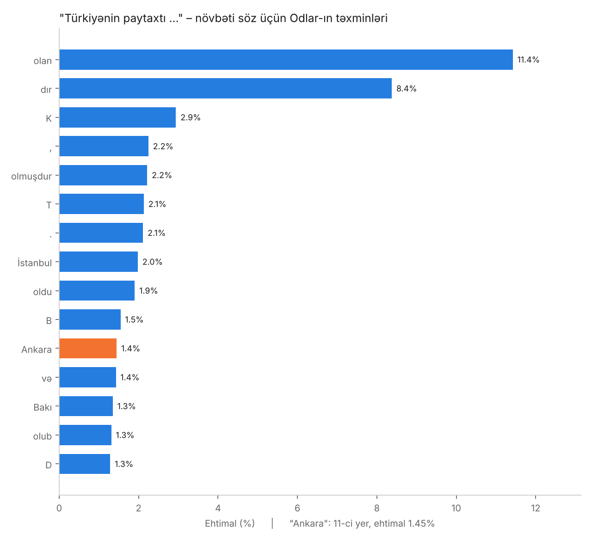

# Odlar-1: "paytaxt" testi

Fikir Türk "Çırak" modeli (5.8M parametr) haqqında videodan götürülüb: modeldən paytaxtı soruşub növbəti söz üçün verdiyi ehtimallara baxırıq.
Skript: [`../ehtimal.py`](../ehtimal.py)

| Sual | Düzgün cavab | Yeri | Ehtimalı | 6 cəhddə Odlar nə dedi |
|---|---|---|---|---|
| Azərbaycanın paytaxtı | Bakı | **1** | **19.6%** | 5 cəhddə 3 dəfə Bakı; həmçinin "Ankara", "Hümmətabad şəhəri" |
| Fransanın paytaxtı | Paris | 1 | 5.9% | Afina, Paris, Helene, Londonda, ... |
| Türkiyənin paytaxtı | Ankara | 11 | 1.4% | Ankara 1 dəfə, qalanları "olan", "oldu" |
| Gürcüstanın paytaxtı | Tiflis | 12 | 1.3% | Afina, "Gürcüstanı", "olan" ... |

## Nəticə
- Odlar "bilmir", **mərc edir**: hər addımda 8000 söz parçasına ehtimal paylayır və zər atır. Ona görə eyni sual fərqli cavablar alır.
- Azərbaycan Vikipediyasında "Bakı" sözü çox tez-tez keçir, ona görə Bakı 1-ci yerdədir. Ankara və Tiflis isə daha az keçir və 11–12-ci yerlərə düşür. Model faktı yox, **mətndəki tezliyi** öyrənib.
- Düzgün cavab 1-ci yerdə olanda belə, ehtimalı cəmi 6–20%-dir. Qalan 80–94% səhv cavablara və ya başqa davamlara gedir.
- ChatGPT kimi böyük modellər də eyni prinsiplə işləyir, sadəcə ehtimal düzgün cavabda daha çox toplanır. Bilmədikləri sualda isə eyni inamla uydururlar (hallucination).
